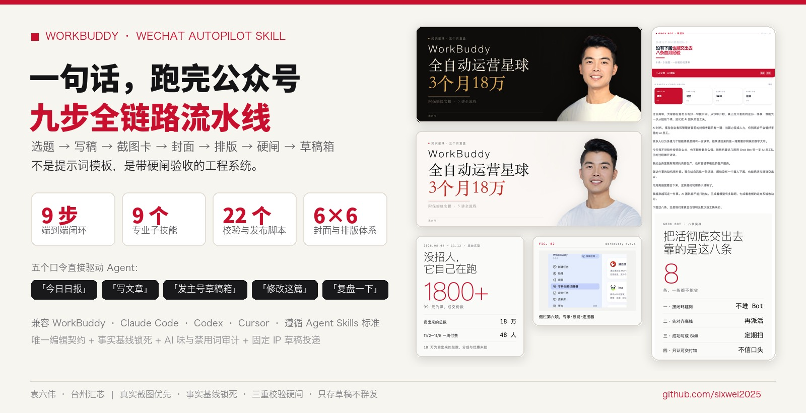
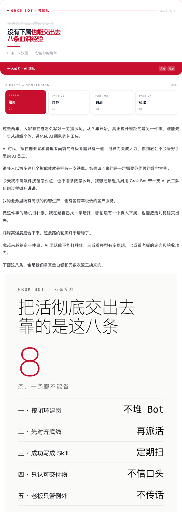
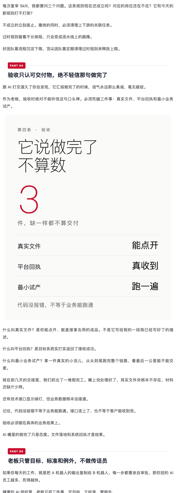
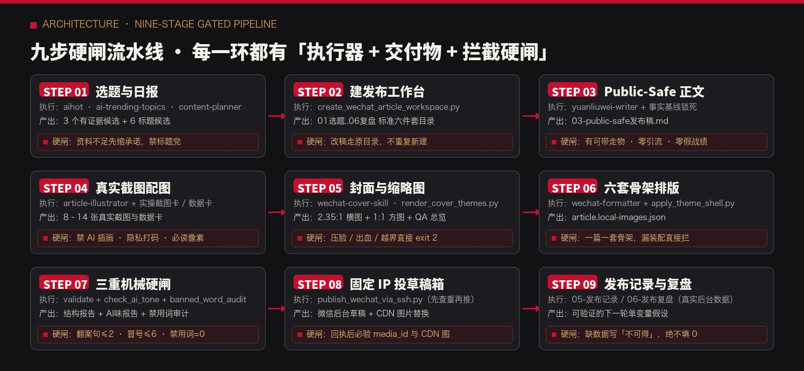
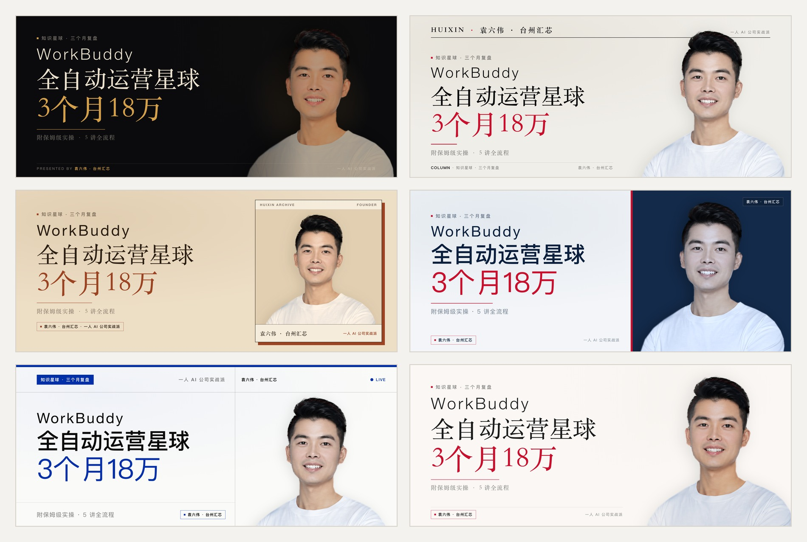
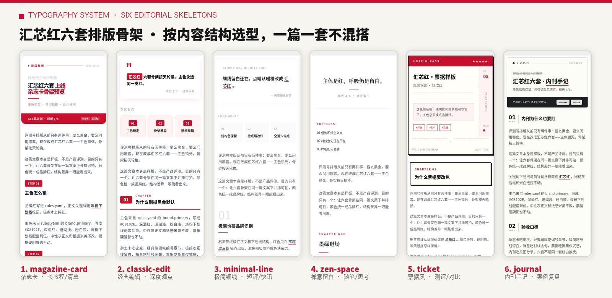
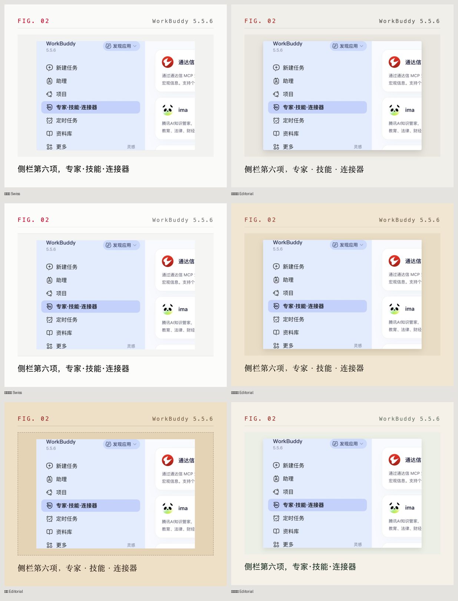
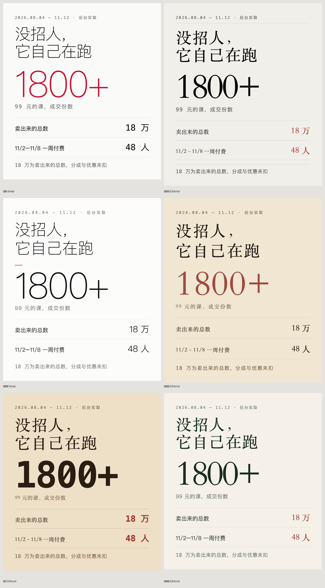

<div align="center">



# WorkBuddy 公众号全链路自动化 Skill
### `wechat-autopilot` · 从热点选题到微信草稿箱成品的九步全自动工作流

[](https://agentskills.io)
[](#七3-分钟安装与首次配置)
[](#三九步全自动流水线怎么跑的)
[](#八开源安全与诚实边界)

> 🔴 **作者：袁六伟 · 台州汇芯**｜一人 AI 公司创业者，学员 7000+，客户 100+，得到 / 华为分享老师  
> 📮 更多 AI 工具实测与自动化实战，关注 **公众号 / 视频号：袁六伟**  
> 📌 **当前版本**：`v1.1.0`（2026-11-13）· 新增 6 套差异化封面构图版式 · 详见 [CHANGELOG.md](CHANGELOG.md)

**不是「帮你写文章」的提示词合集，是一套能自动跑、自动审、自动排版的公众号生产系统。**  
把一个选题跑成微信公众号草稿箱里的成品：**热点选题 → 选题决策 → Public-Safe 写稿 → 真实截图配图 → 封面渲染 → 六套骨架排版 → 三重自动质检 → 固定 IP 草稿投递 → 数据复盘**。

```bash
# 方式 A：通过 skills CLI 一键安装（推荐，自动识别 Claude Code / Cursor / Codex / WorkBuddy）
npx skills add sixwei2025/workbuddy-wechat-autopilot

# 方式 B：克隆仓库并运行环境初始化与自检脚本
git clone https://github.com/sixwei2025/workbuddy-wechat-autopilot.git wechat-autopilot
cd wechat-autopilot && bash install.sh
```

[看成品效果](#一看成品效果) · [五个口令](#二五个口令说人话直接驱动) · [九步流水线](#三九步全自动流水线怎么跑的) · [封面与排版体系](#四视觉系统6-套封面--6-套排版骨架) · [三重自动质检](#五质量护城河为什么它写出来不像-ai-塑料文) · [安装配置](#七3-分钟安装与首次配置)

</div>

## 版本记录

当前版本：`v1.0.0` · 2026-11-13
完整变化记录见 [CHANGELOG.md](CHANGELOG.md)。


## 新手安装：把链接发给 AI

打开 Codex、WorkBuddy，或其他支持技能安装的 AI 智能体，把下面这段话直接发到对话框，让它帮你安装：

```text
帮我安装这个仓库里的技能：
https://github.com/sixwei2025/workbuddy-wechat-autopilot
```

不需要自己先敲安装命令，按 AI 的提示完成即可。安装后可以接着问：“这个技能怎么用？带我做一个最简单的例子。”

需要使用能够读取仓库、操作本地文件并支持技能安装的 AI；如果当前平台不支持，它可以提供手动安装指引。部分技能还需要额外软件或账号配置，安装技能与完成这些配置是两步，按本页说明和 AI 提示继续。


---

## 一、看成品效果

以前写一篇公众号：开六个窗口、查热点、抠字眼、手动调行距、逐张截屏传图、做封面、去后台点二十次。  
现在：**跟 Agent 说一句「写篇关于 XX 的文章，发主号草稿箱」，然后看它跑完九步流程，把成品推到微信后台草稿箱。**

真正省掉的不是打字时间，是**每次都要重新交代一遍的那些规矩**——段落不能超 80 字、红色锚点只能点 3–6 处、封面人像绝不做黑白且不能压脸、广告法禁用词零命中、投递后必须回读 CDN 图片防破图。这些规矩现在全部写进了自动化脚本和质检规则里，不靠人脑记。

### 1.1 真实成稿切片（375px 手机视口直出）

下面是本流水线全自动跑出的真实草稿切片（`magazine-card` 杂志卡骨架 + 汇芯红 `#C8102E` 锚点 + 真实数据卡内嵌）：

<table>
  <tr>
    <td width="50%" align="center">
      
      <br /><sub><b>▲ 开篇首屏</b>：顶栏期号 + 标题重点划线 + 章节导览卡 + 首屏数据总结卡</sub>
    </td>
    <td width="50%" align="center">
      
      <br /><sub><b>▲ 正文推进</b>：2–3 行短段落（每段≤80字）+ 章节红标锚点 + 关键判断数据卡</sub>
    </td>
  </tr>
</table>

---

## 二、五个口令（说人话直接驱动）

装好之后不用背命令、不用解释流程，直接对你的 Agent 说这五个词：

| 你对 Agent 说 | 触发范围 | 交付给你的东西 |
| :--- | :--- | :--- |
| **「今日日报」** | 第 1 步 | 抓取 24h AI 热点与爆款异常值，出 **3 个有真实材料支撑的选题候选 + Top1 推荐 + 每个 6 条标题 + 风险提示**（只出选题，不写稿） |
| **「写文章」** | 第 1–7 步 | 建好标准六件套工作台，完成正文、真实截图卡、封面、六套骨架装配，并跑完**结构 / 去 AI 味 / 禁用词三重自动质检**，停在本地成品等你检阅 |
| **「发主号草稿箱」** | 第 1–8 步 | 一路跑通并通过固定 IP 出口推入微信公众号后台草稿箱（**这句话本身即授权**，自动查重 `add/update`，回读 `media_id` 与 CDN 图片） |
| **「修改这篇」** | 原位更新 | 在原工作台目录修改，查重定位原 `media_id` 直接更新，保留旧版备份，**绝不新建重复草稿** |
| **「复盘一下」** | 第 9 步 | 读取真实后台导出数据，按同时间窗口（24h / 72h / 7d）对照中位数，输出下一篇**单变量可验证改动假设** |

---

## 三、九步全自动流水线（怎么跑的）

<p align="center">
  
</p>

本仓库的核心设计理念是：**一步不过就停在当步修正，绝不带病往下走**。每一环都明确规定了「谁执行、出什么交付物、按什么标准把关」：

| 步 | 环节 | 执行模块 / 脚本 | 交付物 | 质量把关标准（不过直接打回） |
| :---: | :--- | :--- | :--- | :--- |
| **01** | **选题与日报** | `skills/aihot` → `ai-trending-topics` → `content-planner` | `01-选题卡.md`（3 候选 + 各 6 标题） | 资料不足先缩承诺，严禁靠夸张标题补救无证据选题 |
| **02** | **建发布工作台** | `create_wechat_article_workspace.py` | `01选题`..`06复盘` 标准六件套目录 | 改稿必须走原目录，不许重复新建工作台 |
| **03** | **Public-Safe 正文** | `skills/yuanliuwei-writer` + `fact-baseline.md` | `03-public-safe发布稿.md` | 必含 1 个可带走成果；外部案例统一「我有一个朋友」；**正文零引流、禁用词零命中** |
| **04** | **真实截图配图** | `skills/article-illustrator` + 实操截图卡/数据卡 | 8–14 张真实截图与数据卡 | **禁用 AI 插画充当配图**；裁除价格与无关边栏；隐私必打码；出图后必读实际像素防破图 |
| **05** | **封面与缩略图** | `skills/wechat-cover-skill` (`render_cover_themes.py`) | 2350×1000 母版 + 900×383 横图 + 1:1 方图 + `cover_sheet.png` | **版面防遮挡自动校验**：压脸 / 越过 1:1 裁切线 / 缺脸直接 `exit 2` 重渲；必检 200px 缩略图 |
| **06** | **六套骨架排版** | `skills/wechat-formatter` + `apply_theme_shell.py` | `article.local-images.json` (内联 CSS HTML) | 按内容结构选骨架（不按星期轮换）；**必跑 `apply_theme_shell.py` 补齐开篇/目录/END** |
| **07** | **三重自动质检** | `validate_wechat_article.py` + `check_ai_tone.py` + `banned_word_audit.py` | 结构校验 + `ai-tone.json` + 禁用词审计 | 段落 ≤80 字；**翻案句 ≤2、结论冒号 ≤6、顿号连排 ≤4**；广告法极限词 = 0 |
| **08** | **固定 IP 投草稿箱** | `publish_wechat_via_ssh.py` / `find_draft_via_fixed_ip.py` | 微信后台草稿 + `media_id` | 先查重再 `update/add`；遇腾讯 WAF 501 自动走删旧重加；**回执 ok 后必验 CDN 图** |
| **09** | **记录与复盘** | `05-草稿箱发布记录.md` + `06-发布复盘.md` | 投递档案 + 同窗口数据复盘 | 仅在有真实后台数据时执行复盘；缺失指标一律写「不可得」，绝不填 0 或编造表现 |

---

## 四、视觉系统：6 套封面 × 6 套排版骨架 × 6 套配图皮肤

好公众号第一眼看封面，第二眼看排版呼吸感，第三眼看配图真不真。本仓库把这三件事全部做成了**确定性代码渲染**。

### 4.1 封面六套（Editorial 编辑设计范式 + 防压脸自动校验）

告别「五段金色渐变 + 3D 投影 + 红色径向光晕」的廉价电商风。内置 `render_cover_themes.py`（Python + Headless Chrome 渲染），同一篇 brief、同一张真人抠像，一键直出 6 套高客单价杂志封面：

<p align="center">
  
</p>

| 主题 ID | 名称 | 底色 / 锚点色 | 人像处理策略 | 适用题材 |
| :--- | :--- | :--- | :--- | :--- |
| `midnight` | **午夜墨** | `#0E0D0C` / `#D4A04A` 暖金 | 按亮度选择性压暗（白 T 压成中灰、脸部高光保住） | 带硬数字的结果复盘、搞钱算账、深夜深度长文 |
| `paper` | **纸本墨** | `#F1EFEA` / `#0A0A0B` 纯墨 | 低饱和彩照（保留肤色血色，只压艳度） | 方法论、核心观点、体系化教程 |
| `kraft` | **牛皮纸** | `#EEDFC7` / `#9B5A2E` 焦糖 | 暖调低饱和（复古感靠纸底色，不靠抽色） | 个人经历、创业踩坑、故事复盘 |
| `indigo` | **靛蓝瓷** | `#F1F3F5` / `#315D93` 靛蓝 | 冷调半去饱和 | AI 工具实测、产品发布、技术方案拆解 |
| `swiss` | **瑞士蓝** | `#FAFAF8` / `#002FA7` 克莱因蓝 | 低饱和彩照 + 顶部 26px 瑞士蓝横条 | 行业发布、工具清单、对比评测表 |
| `brand` | **汇芯红** | `#FAF7F4` / `#C7352D` 品牌红 | 原色彩照轻压暗 | 通用主力，与正文汇芯红排版视觉完全一致 |

> **🔴 三条写进代码的封面造型原则：**
> 1. **真人照片绝不做纯黑白**：中文语境里纯黑白真人照极其诡异，代码层面已移除 `bw` 模式，统一用「低饱和 + 纸感底 + 大留白」做高级感。
> 2. **字号越大、字重越轻**：主标题 150px / 500 字重，数字行 184px / **400 字重**——这是杂志风与廉价信息图横幅的分水岭。
> 3. **防压脸与裁切线自动检查（`exit 2`）**：渲染时自动测量版面边界，标题右界越过 `1334px`（1:1 裁切线）、文字压入人脸框、或人像头部不完整，脚本直接报错退出并要求改 brief 重渲。同时自动导出 `cover_sheet.png` 四联缩略图供 200px 视口核验：

<p align="center">
  
  <br /><sub>▲ 每次渲染自动生成 <code>cover_sheet.png</code>：同时检查 2.35:1 横图、1:1 分享方图（脸部必须完整居中）与 200px 手机列表缩略图可读性</sub>
</p>

---

### 4.2 正文排版六套骨架（100% 内联 CSS · 防微信后台吞样式）

微信公众号编辑器会吞掉 `<style>`、`class`、`grid` 和复杂渐变。`skills/wechat-formatter` 将 **汇芯红 `#C8102E` 品牌家族** 封装为 6 套纯内联样式（Inline CSS）骨架，并通过 `scripts/apply_theme_shell.py` 自动装配**开篇引言卡、本文看点、章节号、END 分割线与文末三连**：

<p align="center">
  
</p>

| 骨架 ID | 风格名称 | 版式结构特征 | 怎么选（按内容结构选，不按星期轮换） |
| :--- | :--- | :--- | :--- |
| `magazine-card` | **杂志卡** | 顶栏红标 + 滑动章节导览卡 + `STEP 01` 红底胶囊 | **长教程 / 多步骤实操 / 清单体**（吃信息密度） |
| `classic-edit` | **经典编辑** | 双引号引言卡 + 三宫格看点 + `01 CHAPTER` 粗红线 | **深度观点 / 商业评论 / 行业拆解**（吃论证层次） |
| `minimal-line` | **极简细线** | 超大浅灰数字编号 + 1px 细线留白 + 极少红锚点 | **短观点 / 快讯解读 / 轻量随感**（吃呼吸感） |
| `zen-space` | **禅意留白** | 居中衬线宋体大标题 + 极简章节分割 + 宽行距 | **个人随笔 / 深度思考 / 创业心法**（吃克制感） |
| `ticket` | **票据风** | `HUIXIN PASS` 撕票虚线头图 + 硬阴影边框章节盒 | **工具测评 / 方案对比 / 选型指南**（吃仪式感） |
| `journal` | **内刊手记** | 黑底白字期号条 + 左侧竖排 `01 PART` 编号 + 灰框结语 | **项目复盘 / 实战案例 / 内部方法论**（吃档案感） |

---

### 4.3 正文配图皮肤：真实实操截图卡 + 整理型数据卡

2026-11 起，本流水线**彻底废除 AI 插画 / 概念黑图充当正文配图**。正文配图只认两种高信任度交付物，且自动匹配当前文章所选的六套骨架皮肤：

<<<<<<< Updated upstream
> **① 真实实操截图卡（6 套皮肤）** — 带 `FIG` 编号、工具版本标、噪音裁切与图注，读者一眼看出「真跑过」：

<p align="center">
  
</p>

> **② 结构化数据卡（6 套皮肤）** — 无界面可截的抽象关系或账目复盘，用高对比度排版卡呈现，随当前骨架自动换肤：

<p align="center">
  
</p>
=======
<table>
  <tr>
    <td width="50%" align="center">
      
      <br /><sub><b>① 真实实操截图卡</b>：带 FIG 编号、工具版本标、噪音裁切与图注，读者一眼看出「真跑过」</sub>
    </td>
    <td width="50%" align="center">
      
      <br /><sub><b>② 结构化数据卡</b>：无界面可截的抽象关系/账目复盘，用高对比度排版卡呈现，随骨架换肤</sub>
    </td>
  </tr>
</table>
>>>>>>> Stashed changes

---

## 五、质量护城河：为什么它写出来不像 AI 塑料文？

市面上 90% 的写作 Prompt 产出的文章都有一股浓重的「AI 塑料味」：开头宏大叙事、满屏 Emoji、动辄「不是…而是…」「底层逻辑」「闭环抓手」、甚至为了凑案例自己编造客户和收入数字。

本仓库用 **1 份唯一编辑契约 + 67 对真实改稿反推的审稿附录 + 3 个自动质检脚本** 把这些问题消灭在投递前：

### 5.1 核心事实自动核对（防幻觉编造）
- 所有关于作者身份、学员数、客户数、课程定价、真实案例的描述，**只准从 `~/.config/wechat-autopilot/fact-baseline.md` 读取**。
- 资料包里没有的数字一律标「待确认」，不准凭模型记忆编造；外部看到的案例一律以「我有一个朋友」转述，严禁把别人的公开分享写成自己的亲历战绩。

### 5.2 内外表达分界（防工具元叙事漏进正文）
- `references/editorial-contract.md` 明确划定红线：**读者不需要知道我们怎么取证**。
- 严禁把「未登录」「抓不到」「工作台」「按 Skill」「media_id」「统一事实表」等内部排产黑话写进正文；正文只留干净结论、干净数字与读者能直接带走用的清单/框架。

### 5.3 从 67 对真实人工改稿反推的「七条文风判据」
基于 Meta AI《Unslopping AI》实证，让大模型用通用标准自评时，AI 腔胜率高达 100%。因此我们在 `references/审稿判别附录.md` 中从 67 篇真实初稿 vs 终稿对照里提炼出 7 条客观判据：
1. **开篇放现场**：前 3 段必须有具体的人在做具体的事，或一句引号里的真实原话，严禁以「很多人」「大多数人」开场。
2. **小标题自带判断**：小标题抽出来连读必须是一条完整论证链（如 `03 第一个意外：贵的没有算对`），严禁纯名词标签（如 `二、核心数据`）。
3. **重判断前有担保**：抛出核心论断前 3 行内，必须给出与该判断匹配的真实经历担保。
4. **抽象机制挂生活类比**：讲完看不见摸不着的技术机制，紧跟一句读者日常经验类比（如交补、餐补、年假）。
5. **去 AI 句式硬指标**：`scripts/check_ai_tone.py` 自动扫描全文——
   - **翻案句**（「不是…而是…」「与其说…不如说…」）全文 **≤ 2 处**
   - **结论冒号**（「说白了：」「一句话：」「核心就一条：」）全文 **≤ 6 处**
   - **三连顿号排比**（A、B、C 密集堆砌）全文 **≤ 4 处**

### 5.4 三重自动质检（投递前必跑命令）

```bash
# ① 文章结构与微信格式兼容检查（段落≤80字 / 图片数 / 重复标题 / 本地路径残留 / 零乱码校验）
python3 skills/wechat-auto-publisher/scripts/validate_wechat_article.py \
  --article article.local-images.json --max-paragraph 80

# ② AI 味量化检测（只出 JSON 诊断报告，人工点头后最小改动命中句）
python3 scripts/check_ai_tone.py 03-public-safe发布稿.md --json ai-tone.json

# ③ 广告法极限词与违规词零容忍审计（保证 / 100% / 最 / 第一 / 唯一 / 国家级 等）
python3 scripts/banned_word_audit.py 03-public-safe发布稿.md
```

---

## 六、这套系统适合谁？（以及怎么改成你自己的）

| 契合度 | 适用人群与业务场景 | 你能直接拿走什么 |
| :---: | :--- | :--- |
| **极高** | **一人公司 / 独立开发者 / AI 工具博主 / 知识付费与教培 / B 端咨询顾问** | 整条九步流水线开箱即用，一个人跑完「情报→写稿→截屏→封面→排版→草稿箱」，不用养编辑团队 |
| **高** | **企业市场部 / 内容代运营团队 / 垂直行业老板写号** | 把主编脑子里的「审稿标准」写成自动质检规则，实习生或新员工接手也不掉底线 |
| **中** | **实体店获客 / 制造业出海 / 财税法律科普** | 骨架和校验器通用，只需按下方 5 步替换你的事实口径与行业词表 |

### 5 步改成你自己的品牌流水线

1. **填你的事实基线**：复制 `assets/fact-baseline.example.md` 到 `~/.config/wechat-autopilot/fact-baseline.md`，填好你的身份、真实业务数据、产品名和绝对不能踩的红线。
2. **换你的封面真人抠像**：用 `skills/wechat-cover-skill/scripts/make_cutout_hd.py` 把你的半身照抠成透明底 PNG，替换 `owner_portrait.jpg` 与抠像资产（自动保留人脸框防压脸保护）。
3. **换你的品牌主色**：在 `skills/wechat-formatter/themes/` 中将主色 `#C8102E` 改为你的品牌色（「一套只用一个锚点色」的克制纪律保持不动）。
4. **换你的文末产品海报**：替换 `assets/ending-poster-product.jpg`（切记：**不要放带二维码的海报**，防微信平台判定营销导流限流）。
5. **换你的口音样本**：往文风参考里放 3–5 篇你自己最满意的改定稿，让 `yuanliuwei-writer` 锁定你的说话节奏。

---

## 七、3 分钟安装与首次配置

### 1. 克隆仓库并初始化配置目录

```bash
git clone https://github.com/sixwei2025/workbuddy-wechat-autopilot.git wechat-autopilot
cd wechat-autopilot
bash install.sh
```

`install.sh` 会自动在 `~/.config/wechat-autopilot/` 下生成配置文件模板（如果已存在则安全跳过，绝不覆盖）。

### 2. 填写两个本地私有文件（只做一次）

```bash
# ① 填写你的唯一事实源（身份、数字、履历、红线口径）
$EDITOR ~/.config/wechat-autopilot/fact-baseline.md

# ② 填写公众号 API 凭证与固定 IP 白名单出口服务器（仅投递草稿箱时需要）
$EDITOR ~/.config/wechat-autopilot/wechat.env
```

> 🔒 **安全承诺**：`~/.config/wechat-autopilot/` 位于仓库外部，且 `.gitignore` 已严格拦截 `.env` 与私有基线文件。凭证永不进仓库、不在终端回显。

### 3. 挂载到你的 Agent

遵循开放的 [Agent Skills](https://agentskills.io) 规范，支持 WorkBuddy、Claude Code、Codex、Cursor 等所有兼容 `SKILL.md` 的智能体：

```bash
# WorkBuddy
ln -s "$PWD" ~/.workbuddy/skills/wechat-autopilot

# Claude Code
ln -s "$PWD" ~/.claude/skills/wechat-autopilot

# Codex
ln -s "$PWD" ~/.codex/skills/wechat-autopilot
```

### 4. 环境依赖

- **Python 3.9+** + `Pillow` / `numpy` / `scipy` / `PyYAML`（封面图像处理与版面校验）
- **Google Chrome 或 Chromium**（无头渲染封面与截取真实网页，可通过 `CHROME_BIN` 指定路径）
- **中文字体**：仓库已内置开源超粗黑体 `NotoSansCJKsc-Black.otf`（SIL OFL 1.1 许可，开箱即用）
- **公众号草稿投递（可选）**：需公众号主号 `AppID` / `AppSecret` 及配置了 IP 白名单的固定出口服务器（微信公众号 API 强制校验出口 IP 白名单）

---

## 八、仓库全景目录

```text
workbuddy-wechat-autopilot/
├── SKILL.md                           # 【总控入口】九步流水线编排、五条视觉硬指标与口令路由
├── install.sh                         # 一键初始化 ~/.config/wechat-autopilot 配置目录
├── references/                        # 【规则与宪章层】
│   ├── editorial-contract.md          # ★ 唯一编辑标准（所有子技能冲突时一律以它为准）
│   ├── 审稿判别附录.md                # 从 67 对真实改稿反推的 7 条文风判据（防 AI 腔）
│   ├── visual-policy.md               # 主号高客单价视觉宪章（贵 = 克制）
│   ├── typography.md                  # 手机 375px 视口字号、行高、边距与图注细则
│   ├── 组件库.md                      # ::: 容器语法（引言卡/数据卡/对比卡/步骤卡）兜底规范
│   ├── public-safety.md               # 对外发布安全口径与脱敏红线
│   ├── publishing-notes.md            # 固定 IP 服务器投递、WAF 501 处置与 CDN 核验说明
│   ├── 教程类爆款方法.md              # 教程类文章高收藏结构拆解
│   ├── 教程类文章范本.md              # 标杆范文结构参考
│   └── roles/                         # 六个专业角色定义（支持多 Agent 专家团编排）
├── scripts/                           # 【主控校验与发布脚本】
│   ├── apply_theme_shell.py           # 六套骨架装配器（补齐主题开篇/目录/章节/END，第6步必跑）
│   ├── check_ai_tone.py               # AI 味量化检测器（翻案句/结论冒号/三连顿号，第7步必跑）
│   ├── banned_word_audit.py           # 广告法极限词与违规词审计器（第7步必跑）
│   └── publish_wechat_via_ssh.py      # SSH 固定 IP 白名单草稿箱投递与回读校验（第8步）
├── skills/                            # 【九大专业子技能】
│   ├── aihot/                         # 1. 24小时中文 AI 资讯与热点同步（只读匿名 API）
│   ├── ai-trending-topics/            # 2. 跨平台爆款选题挖掘与异常值拆解
│   ├── content-planner/               # 3. 选题决策、三门槛评估与 6 变体标题生成
│   ├── yuanliuwei-writer/             # 4. 第一人称实战派写稿（核心事实核对 + 可带走成果）
│   ├── article-illustrator/           # 5. 阅读节奏配图规划（真实截图卡 + 数据卡）
│   ├── wechat-cover-skill/            # 6. 封面渲染引擎（6套杂志风 + 黑红金v2b + 防压脸自动校验）
│   ├── wechat-formatter/              # 7. 汇芯红六套排版骨架（100% 内联 CSS）
│   ├── wechat-auto-publisher/         # 8. 工作台创建、Markdown→WeChat JSON 转换与结构校验
│   └── ian-xiaohei-illustrations/     # 9. 手绘概念解释图（自动化主号默认关闭，保留备用）
└── assets/                            # 【模板、静态资产与效果展示】
    ├── fact-baseline.example.md       # 唯一事实源配置模板
    ├── wechat.env.example             # 公众号 API 与固定 IP 凭证模板
    ├── topic-card-template.md         # 01-选题卡模板
    ├── source-pack-template.md        # 02-资料包模板
    ├── public-safe-checklist.md       # 03-对外安全自检表
    ├── draft-record-template.md       # 05-草稿箱发布记录模板
    ├── review-template.md             # 06-真实数据复盘模板
    ├── ending-poster-product.jpg      # 文末无二维码产品介绍海报
    ├── owner_portrait.jpg             # 默认封面真人底板
    └── showcase/                      # README 视觉展示图集
```

---

## 九、开源安全与诚实边界

- **只进草稿箱，绝不自动群发**：整条流水线的终点永远是微信公众号后台的「草稿箱预览」。最后一步群发必须由真人在微信后台点击。
- **不含任何私钥与敏感数据**：仓库内的 `.example` 均为脱敏占位符，真实凭证只存在你本机的 `~/.config/wechat-autopilot/`。
- **不承诺阅读量与爆款概率**：我们的编辑目标是每篇争取 2–5 万阅读，但这套工具省下的是重复劳动和返工成本，不是替你做商业判断。它拒绝输出「本文评分 95 分」「爆款概率 80%」这类毫无数据支撑的自嗨打分。
- **不虚构实测**：如果某个实时操作或网页截图在当前环境没跑通，Agent 会如实报告缺口，绝不画一张假图或编造一句「亲测成功」糊弄过去。

---

## 十、关于作者与开源生态

**袁六伟 · 台州汇芯**：一人 AI 公司创业者，学员 7000+，服务商单客户 100+，得到 / 华为分享老师。专注 AI 工具实测、短视频工程化与业务全流程自动化落地。

- 公众号：**袁六伟**（微信搜一搜关注，看这套流水线每天跑出来的真文章）
- 视频号：**袁六伟**

这个 Skill 免费开源。如果它帮你的内容产线省下了每天两小时的排版、配图和改稿内耗，欢迎在右上角点个 ⭐ **Star**，也欢迎转发给身边自己写号的一人公司朋友。

### 同系列开源 Skill 矩阵

| 仓库 | 定位 | 许可 |
| :--- | :--- | :--- |
| [**workbuddy-wechat-autopilot**](https://github.com/sixwei2025/workbuddy-wechat-autopilot) | WorkBuddy 公众号九步全链路自动化总控（本仓库） | 开源 |
<<<<<<< Updated upstream
| [**ai-auto-wechat-publisher**](https://github.com/sixwei2025/ai-auto-wechat-publisher) | AI 全自动化公众号八段式方法论与模板库 | MIT |
| [**wechat-cover-skill**](https://github.com/sixwei2025/wechat-cover-skill) | 公众号封面渲染引擎（封面六套 + 黑红金 + 防压脸自动校验） | MIT |
| [**gzh-million-layout-skill**](https://github.com/sixwei2025/gzh-million-layout-skill) | 公众号百万大号排版六套骨架 | MIT |
| [**ai-tool-review-wechat-skill**](https://github.com/sixwei2025/ai-tool-review-wechat-skill) | 汇芯红六套排版骨架与 AI 工具测评工作流 | MIT |
=======
| [**wechat-cover-skill**](https://github.com/sixwei2025/wechat-cover-skill) | 公众号封面渲染引擎（封面六套 + 黑红金 + 几何硬闸） | MIT |
| [**ai-tool-review-wechat-skill**](https://github.com/sixwei2025/ai-tool-review-wechat-skill) | 汇芯红六套排版骨架与 AI 工具测评工作流 | MIT |
| [**3d-map-video-skill**](https://github.com/sixwei2025/3d-map-video-skill) | 3D 地图讲城市/历史/战争竖屏短视频全链路渲染引擎 | MIT |
| [**talking-head-video-skill**](https://github.com/sixwei2025/talking-head-video-skill) | 真人口播短视频自动化包装与剪辑 Skill | MIT |
>>>>>>> Stashed changes

---

## 许可证与致谢

- 本仓库架构、编辑契约与文档归作者袁六伟所有。
- 内置组件许可：
  - `skills/wechat-formatter` 六套骨架：源自 [`sixwei2025/ai-tool-review-wechat-skill`](https://github.com/sixwei2025/ai-tool-review-wechat-skill)（MIT License）
  - `skills/wechat-cover-skill`：源自 [`sixwei2025/wechat-cover-skill`](https://github.com/sixwei2025/wechat-cover-skill)（MIT License）
  - `skills/aihot`：MIT License
  - `NotoSansCJKsc-Black.otf` 字体：SIL Open Font License 1.1
